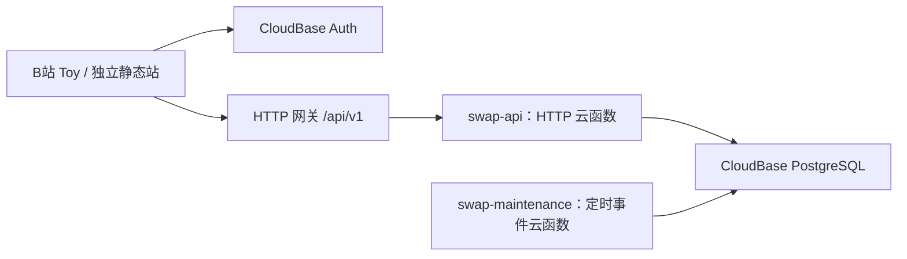

# CloudBase 后端概要设计

> 2026-11-13 · v1 设计方案，后端实现及发布状态见 [后端说明](../backend/README.md)。业务规则沿用 [产品设计](design.md)；本文替代原后端接口和基础设施草案。

## 1. 目标与范围

为 B站 Toy 和独立静态站提供同一个换牌匹配池，将原草案的 **21 个接口精简为 11 个**。首版采用 CloudBase Auth、云函数和 PostgreSQL，不引入 Redis、独立事件系统或 Web Push。

Box 继续本地优先，B站用户仍通过 Toy 云存储同步；后端只保存发布的换牌需求与交换记录。严格 1 换 1、主动扫描最多 3 对、被动匹配不限、各服 04:00 刷新次数、48 小时有效期等规则保持不变。

**UID 仅作为游戏匹配信息**：不同交换账号可以填写相同 UID，分别发布需求并正常匹配。所有入口共用匹配后端，但不按 UID 去重、合并账号或共享进度；重复 UID 不产生提示、标记或额外操作。

## 2. 总体架构

| 组件 | 职责 |
|---|---|
| CloudBase Auth | 匿名登录、自定义登录、访问令牌与会话续期 |
| `swap-api` | 一个 Node.js HTTP 云函数，按路由处理身份关联、需求、匹配和反馈 |
| PostgreSQL | 业务数据、匹配查询、事务、占用控制和限频；无需另建缓存服务 |
| `swap-maintenance` | 每分钟处理超时匹配、释放占用和到期状态；重复执行不重复结算 |

前端保持 Vite 静态构建，Toy 包部署到 B站，独立站可部署到 CloudBase Web 应用托管。HTTP 云函数按平台要求监听 9000 端口；网关统一处理跨域，允许实际 Toy 来源与独立站来源。

## 3. 身份与权限

- **匿名用户**：首次发布前通过 CloudBase SDK 匿名登录，会话由 SDK 在当前设备保存；清除设备数据后无法恢复原身份。
- **B站用户**：保留 Toy 云存储中的 `cred`。`POST /session` 验证密钥后签发 CloudBase 自定义登录 Ticket，由 SDK 换取会话；首次使用时生成账号和密钥。密钥写入 Toy 失败时沿用原设计的重试及匿名降级策略。
- **身份边界**：B站与匿名身份不自动合并；`toyOpenId` 经用户授权后仅保存 HMAC，用于去重，不能用于登录或恢复身份，也不提供匹配特权。
- **访问控制**：业务请求携带 CloudBase 访问令牌，由服务端验证并提取交换账号；服务端按账号 ID 检查需求归属与匹配参与方，相同 UID 不授予访问其他账号数据的权限。浏览器不能直接读写业务表或调用内部结算 RPC，避免绕过 UID 展示和卡牌占用规则。
- **账号独立**：需求、卡牌占用、次数、信用、冷却和失败屏蔽均以交换账号为单位。同一账号在多个设备使用时共享这些状态，不同账号即使填写相同 UID 也各自独立，无需关联账号。

不再维护自建 Session 表或独立的 token 续期接口。上线前需启用匿名登录、自定义登录，并配置公开访问密钥与安全域名；签票私钥和服务端 API Key 仅注入云函数。

## 4. 精简接口

REST + JSON，前缀统一为 `/api/v1`。`/config` 可公开读取；`/session` 以 B站账号密钥建立身份，其余接口要求有效会话。

| 方法 | 路径 | 用途与主要内容 |
|---|---|---|
| GET | `/config` | 仅返回当前部署的 `cloudbase.envId`、公开登录密钥 `cloudbase.publishableKey` 和 `authorMid`；静态数据由前端本地模块提供 |
| POST | `/session` | B站身份首次建立或恢复：`{ provider: "bili", credential? }` → `{ ticket, credential? }`；无效密钥返回 401 |
| PUT | `/me` | 更新 `{ uid?, toyOpenId? }`；校验 UID 格式并推导服务器和分区，允许 UID 重复；`toyOpenId` 仍检查身份关联冲突 |
| GET | `/state?historyCursor=` | 返回本人资料、当前需求、全部进行中匹配、分页历史、每日额度和本分区汇总统计 |
| POST | `/listings` | 发布 `{ give, want, mode, note? }`，消耗一次额度并立即扫描，返回需求及新匹配 |
| PATCH | `/listings/current` | 编辑尚未占用的 give / want / note，不触发主动扫描 |
| DELETE | `/listings/current` | 撤回未占用部分；已经形成的匹配继续有效 |
| POST | `/listings/current/rematch` | 消耗一次额度，主动扫描最多 3 对，返回新匹配 |
| POST | `/matches/:id/reveal` | 开始交换，幂等记录首次查看时间，向参与者返回对方完整 UID |
| POST | `/matches/:id/confirm` | 提交 `{ result, completedPairs?, reason?, note? }`，记录本人确认并按双方结果结算 |
| POST | `/matches/:id/feedback` | 统一申诉与举报，使用 `{ kind: "appeal" 或 "report", reason?, note? }` |

`/state` 返回 `{ me, listing, matches, history, nextHistoryCursor, quota, stats }`，没有当前需求时 `listing: null`，历史默认每页 20 条。有进行中交换时每 10 秒刷新，仅等待匹配时每 30 秒刷新，空闲或页面隐藏时停止轮询。轮询使用 `/state?light=1`，省略历史与全池供需统计；首次加载、回到前台、操作后及交换结束时补拉完整状态。轮询展示被动匹配和对方确认，不单独建设事件流。

需求仍使用 `give: { cardId: qty }`、`want: [cardId]`，每种想要的牌只需要 1 张。编辑请求携带需求版本，过期版本返回 409，已占用的给出数量和想要名额不能被编辑覆盖。匹配返回双方可见的交换对、状态、有效期、查看状态和确认结果；对方资料默认只含 `uidMasked`、服务器、信用等级与留言。仅本人已 reveal 且匹配仍有效时附带完整 UID，结束后不再下发。

合并关系：`/me`、当前需求、匹配列表与详情、`/stats`、`/events` 的查询职责收进 `/state`；`/session/bili-profile` 收进 `PUT /me`；申诉与举报收进 feedback。独立 UID 查询改为前后端复用规则并在绑定时校验；Push 订阅接口推迟到后续版本。

换牌写操作使用账号范围内的请求幂等键，网络重试复用同一个键，避免重复发布、扣次数或结算；幂等记录不缓存登录票据或账号密钥。错误统一为 `{ error: { code, message, retryAt? }, requestId }`；保留 `UID_INVALID`、`DAILY_LIMIT`、`CARDS_LOCKED`、`CREDENTIAL_INVALID` 等业务错误码，UID 重复正常成功且不附带重复状态。

## 5. 数据与匹配

| 数据表 | 主要内容 |
|---|---|
| `accounts` | CloudBase 用户身份映射、账号类型、B站密钥哈希、可选 `toyOpenId` HMAC |
| `players` | 以账号 ID 为主键，保存可重复的原神 UID、服务器 / 分区、信用、冷却、完成数和每日额度 |
| `listings` | 发布账号 ID、UID 快照、分区、give / want、占用数量与想要名额、留言、状态、版本 |
| `matches` | 双方账号 ID、UID 和交换对快照、对应需求、主动扫描账号、双方查看与确认记录、状态、到期时间 |
| `pair_blocks` | 失败的两个交换账号及屏蔽到期时间，避免 30 天内再次匹配；不影响其他同 UID 账号 |
| `feedback` | 举报 / 申诉双方的账号 ID、关联匹配及处理状态 |

另设短期请求记录，保存幂等结果和设备 / IP 写入计数。每个账号保存一个当前 UID、最多一条有效需求；UID 字段不设唯一约束，也不作为业务外键或鉴权依据。按账号、分区、状态和到期时间建立索引，give / want 使用 JSONB 或数组存储。完整 Box、B站昵称和头像不入库。

匹配采用原有贪心规则：同分区按账号 ID 排除自身账号和屏蔽对象，不因 UID 相同排除候选；找双向互补需求，优先换得更多、稀缺牌、信用和等待时长。卡牌占用仅约束各自账号的需求，不按相同 UID 合并库存；同一需求已经占用的给出数量和想要名额不再匹配。

发布、重新匹配及结算由云函数调用**内部 PostgreSQL RPC**：在同一事务中取得分区锁，再校验额度与版本、占用双方卡牌、写入匹配和次数；异常整体回滚。编辑、撤回和定时释放也遵守相同的锁顺序与占用约束，不能依赖云函数实例内存锁。

正常完成路径为 `matched → confirming → completed`，失败、超时或矛盾反馈进入 `failed / expired / disputed`。双方确认、部分完成、矛盾反馈、申诉及超时按产品设计 11.4 结算；已完成部分扣除占用，其余释放，信用调整和回池仅执行一次。撤回后已有匹配仍由原需求记录承接占用，释放不重新激活已撤回需求。每日额度以账号为单位、按其服务器游戏日即时计算，修改 UID 不清空已用次数，也不依赖定时任务恰好在 04:00 运行。

完成确认的补充规则：首次确认完成后，将交换到期时间更新为首次确认时间加 10 分钟，重复提交不重置计时。主动确认相同完成项的双方在成功结算时各加 6 信用分；另一方超过 10 分钟未响应则由每分钟维护任务自动完成，首次确认者加 6 分、自动确认方加 2 分。双方未确认仍维持原有 48 小时到期和处罚规则。等待方页面显示「等待对方确认，如无响应，10分钟后自动确认成功」。

成功换牌后的补充规则：任一方声明完成即结束双方本轮需求，保留已有匹配的占用供后续结算。双方主动确认相同完成项，或单方确认后满 10 分钟自动完成、匹配首次进入 `completed` 时，在同一事务中清空双方 `quota_reset_at`，各恢复 1 次主动发布 / 重新匹配机会；已结束的旧确认重放不再次恢复。等待对方确认期间、失败或争议不恢复额度。前端现有的每 10 秒状态轮询及返回前台刷新同步更新可交换次数。当前全部匹配结束后才允许发布下一轮；信用处罚冷却与发布次数独立。

## 6. 实施顺序与验证

1. 选定站点与支持 PostgreSQL 的 CloudBase 环境，配置认证、安全域名、数据库迁移和仅服务端访问权限。
2. 实现 `swap-api`、匹配 RPC 和定时维护；新增 `src/api/client.js` 适配现有调用，再替换 `src/mock/api.js`，保留原型调试入口。
3. 验证同 UID 的不同账号可以无提示地独立发布和正常匹配，且次数、信用及数据权限互不影响；同时验证双端互换、3 对上限、同一需求的并发占用、重复请求、跨游戏日额度、超时释放和撤回后结算，确认敏感字段不出现在日志中。

CloudBase 平台能力参考：[自定义登录](https://docs.cloudbase.net/authentication-v2/method/custom-login)、[PostgreSQL 数据库函数与事务](https://docs.cloudbase.net/database/postgresql/functions)。具体 SDK 版本和函数调用签名在接入时锁定。
