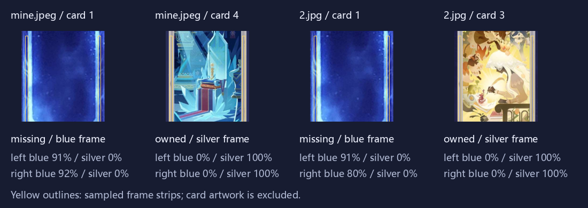

# 米游社图片导入：逐图评估记录（历史）

> 当前实施依据为[自适应识别设计](miyoushe-box-import-flexible.md)。本文保留先前的逐图验证记录；其中固定宽高比、页尾模板及必须检测全部22个框的限制已取消，后续不要沿用。

日期：2026-11-13。基于两张真实导出图和三个合成变体的离线验证，尚未接入网页。

> 第三张图补充：实际文件为 `docs/assets/3.png`，476 × 3349。颜色与“2”角标均可识别，但原页首小字门槛会拒绝它；修订为“页尾标识 + 全部22个双侧牌框校验”后通过。当前低分辨率准入、布局校验和模板用量以第 7 节为准。

## 1. 结论

**`docs/assets/2.jpg` 可以支持。旧方案直接运行会拒绝，但根因是按宽度换算的固定坐标累积偏移，不是牌背模板失效。**

分别按图片宽、高归一化后，现有模板就能完整识别这张图，结果为 **14 / 22 种、共 14 张，没有“2”角标**。未获得 ID 为 `1、2、8、11、13、14、21、22`。

进一步建议将主方案改为：

> **相对坐标定位 + 牌框颜色统计 + 局部数字“2”匹配。**

未获得牌是蓝色框，已获得牌是银灰色框。判断两侧牌框的颜色占比即可确定拥有状态，不再依赖蓝色牌背的具体纹理。数字和布局校验继续使用现有的小模板，不引入 OCR、OpenCV.js、WASM 或模型。

## 2. 两张图片实际有什么不同

| 项目 | `mine.jpeg` | `2.jpg` |
|---|---|---|
| 尺寸 | 1080 × 7616 | 1216 × 8561 |
| 牌数 / 列数 / 顺序 | 22 张、3 列、ID 1–22 | 相同 |
| 只按宽度缩到 540px 后的高度 | 3808px | 约 3802px |
| 旧方案布局检查 | 通过 | 不通过 |
| 分别按宽、高归一化后的模板方案 | 正确：12 种、13 张 | 正确：14 种、14 张 |

假设新图只是旧图完全等比例放大，1216px 宽对应的高度应约为 8575px；实际为 8561px，相差约 **0.16%**。虽然肉眼很难看出，按固定行距推算到末行已累计约 6px 的工作图偏移，超出了原先 ±3px 的搜索范围。

旧方案页尾布局模板的最高相关系数只有 `0.7986`，低于 `0.90` 门槛；分别按宽、高归一化后为 `0.9974`。此时同一张未获得牌背模板也正常命中。

设备绘制或尺寸取整可能导致这种差异；这只是对原因的推测，目前能够确认的是**最终图片存在小幅非等比例差异**。

## 3. 定位修订：分别归一化两个方向

输入仍须是同类完整导出图。先检查原始宽高比与标定图相差不超过 1%，再分别将宽、高映射到 **540 × 3808** 的工作 Canvas，而不是固定宽度后保留计算出的高度。

```js
// 先检查原始图片宽高比及完整版式，不能对任意图片强制拉伸后直接导入。
const aspectError = Math.abs((image.height / image.width) / (7616 / 1080) - 1);
if (aspectError > 0.01) throw new Error('UNSUPPORTED_LAYOUT');
ctx.drawImage(image, 0, 0, 540, 3808);
```

等价的原图相对坐标映射为：

```text
x_input = x_reference / 1080 × inputWidth
y_input = y_reference / 7616 × inputHeight
```

这种归一化只用于同版式中小幅比例差异，不能修复裁剪、增加手机状态栏、切换列数或局部重新排版。原有的页首、页尾模板检查、偏移一致性检查以及区域越界检查继续保留，防止把错误图片识别为完整 Box。

## 4. 推荐的替代判断：看牌框颜色

### 4.1 为什么取牌框，而不是整张卡牌

已获得牌中也有蓝色插画，直接统计整张牌的蓝色比例可能误判。两侧固定银灰边框不随插画变化；蓝色未获得边框则有明显的蓝色差异。因此只采样卡框两侧的窄条。



在 540 × 3808 的工作图上，每个牌位原点仍为：

```js
const x = Math.round((46 + col * 337) / 2);
const y = Math.round((362 + row * 879) / 2);
```

两条采样区相对于该原点为 `[8, 130, 4, 160]` 与 `[144, 130, 4, 160]`，格式为 `[x, y, width, height]`。正式接入时同时应用布局校验得到的整体平移量。

### 4.2 不需要任何图片模板的颜色规则

以下为当前两张导出图标定的初始 RGB 规则，取值范围均为 0–255：

```js
const isBlue = b - r > 35 && g - r > 15 && b > 120;
const isSilver = Math.max(r, g, b) - Math.min(r, g, b) < 35
  && (r + g + b) / 3 > 115;
```

对左右窄条**分别**计算颜色像素占比：

| 条件 | 单条边框判断 |
|---|---|
| 蓝色占比 ≥ 65%，且银灰占比 ≤ 20% | 未获得 |
| 银灰占比 ≥ 65%，且蓝色占比 ≤ 20% | 已获得 |
| 其他情况 | 待确认 |

左右两条结果一致才自动采用，否则待确认。这样既不要求所有像素完全相同，也不通过“不是蓝色”就直接推断为已获得。

两张真实样图共 44 个牌位的实测结果：

| 指标（按每条窄条统计） | `mine.jpeg` | `2.jpg` |
|---|---|---|
| 未获得边框的最低蓝色占比 | 77.2% | 77.7% |
| 未获得边框的最高银灰占比 | 0% | 0% |
| 已获得边框的最高蓝色占比 | 0% | 0% |
| 已获得边框的最低银灰占比 | 100% | 100% |

颜色阈值分割是常规图像处理方法，也可以换成 HSV 的色相 / 饱和度规则。当前样本使用 RGB 已有明显分离空间，先使用几次数值比较即可，不需要引入图像处理库。[颜色阈值分割原理参考](https://docs.opencv.org/4.x/df/d9d/tutorial_py_colorspaces.html)

### 4.3 数量处理

已获得牌继续在相对位置读取角标区域，将数字局部归一化后匹配原始“2”模板。小数字模板不依赖整张图片的像素尺寸，因此没有必要因图片宽度变化而引入 OCR。

保留原方案的角标外圈检查：无角标为 1；有角标且“2”命中为 2；有角标但“2”不命中为待确认；未获得且没有矛盾角标为 0。保留 0–99 的手动修正范围，不把 3 及以上误当作 1。

新样图没有数量 2，因此本次没有第二张真实“2”角标样本。另将 `mine.jpeg` 缩放到 1216 × 8561 制作合成变体，验证比例变化后仍能识别原来的“2”；这不能替代后续更多真实设备数字样本。

### 4.4 体积与计算量

主流程无需加载 `missing-back.png`，运行时 PNG 可由 33,796 B 降到 **20,460 B，约 20 KiB**，分别是两个布局模板、角标外圈和数字“2”。现有牌背素材保留，便于对照或后续验证，不必删除。

牌框颜色判断只遍历 `22 × 2 × 4 × 160 = 28,160` 个像素，省去原先约 1070 万次牌背灰度比较。布局和数字检查仍有各自的计算量，不把这个数字当作整个导入流程耗时，也不据此承诺真机速度。

## 5. 是否需要完全换成其他识别技术

| 方案 | 当前验证 | 取舍 |
|---|---|---|
| 分别归一化宽高，继续使用现有模板 | 两张原图及三个变体均正确 | 修改最少，能解决本次样图差异 |
| **分别归一化宽高 + 牌框颜色 + 数字小模板** | 两张原图及三个变体均正确 | 推荐；更轻量，拥有状态不依赖牌背纹理 |
| 根据颜色和连通区域自动寻找全部卡框，再按位置排序 | 尚未实现或验证 | 可应对真正的头部高度 / 行距变化，但需处理碎片、漏框、22 张牌计数等情况 |
| OCR / 视觉模型 | 没有新增必要性 | 当前布局与颜色规则已足够；会引入额外代码、资源或服务依赖 |

若后续样图出现无法通过宽高归一化消除的局部布局变化，再升级为“蓝色 / 银灰颜色掩码 → 连接相邻像素区域 → 过滤长条卡框 → 按中心坐标聚成行列”。该方向可以用普通 JS 和 TypedArray 实现，不一定需要 OpenCV.js，但目前不将其列为已验证能力。

**首版支持同版式跨设备尺寸变化，不宣称支持任意截图。** 超出布局或颜色范围的图片进入待确认 / 不支持流程，避免错误覆盖 Box。

## 6. 验证产物与后续实现

离线验证脚本：[`scripts/evaluate-miyoushe-layouts.py`](../scripts/evaluate-miyoushe-layouts.py)，仅依赖 Pillow，不修改原有模板或 v1 阈值。

为保留对照证据，开发期验证脚本同时计算旧牌背模板的结果；正式颜色判断流程不需要加载该牌背素材。

```powershell
python scripts/evaluate-miyoushe-layouts.py
```

完整结果见 [跨设备验证报告](fixtures/miyoushe-box-multidevice.validation.json)，新样图人工答案见 [第二张图的 expected.json](fixtures/miyoushe-box-second.expected.json)。五个用例均通过：

1. 原始 `mine.jpeg`：12 种、13 张，恋人 2 张。
2. 原始 `2.jpg`：14 种、14 张，没有 2 张牌。
3. 原图缩到 540px、JPEG quality=60 重压缩：数量一致。
4. 新图缩到 540px、JPEG quality=60 重压缩：数量一致。
5. 原图按新图的宽高作小幅非等比例变换：数量一致，保留恋人 2 张。

这些结果只代表两张真实图片及其变体的离线验证，尚未做网页 Canvas 或真机验证。灰度、缩放和颜色阈值需在浏览器接入时再次确认。

后续实现以本修订的定位和拥有状态判断为准；[原设计文档](miyoushe-box-import.md)中的预览、手动修正、覆盖规则、交换锁定、本地识别及云同步边界继续适用。此次仍只更新设计及验证材料，不开始接入网页。

## 7. 第三张图：低分辨率及页首文字差异

### 7.1 真实结果与旧方案的限制

用户提到的 `3.jpg` 在项目中的实际文件为 **`docs/assets/3.png`**，尺寸 **476 × 3349**，RGBA 格式；所有像素均不透明。

这张图的数量与第一张相同：**12 / 22 种，共 13 张，恋人 2 张**。未获得 ID 为 `1、2、3、7、8、12、14、16、18、19`。它补充了低分辨率和文字渲染差异，不增加新的收藏数量组合。

直接运行第二轮方案会被页首“已解锁：”小字模板拦截。核对结果如下：

| 指标 | 第三张图实测 | 原阈值 | 含义 |
|---|---|---|---|
| 页首文字 ZNCC / MAE | 0.8485 / 0.0804 | ≥ 0.90 / ≤ 0.08 | 拒绝，低分辨率小字不适合作为强制条件 |
| 页尾标识 ZNCC / MAE | 0.9923 / 0.0224 | ≥ 0.90 / ≤ 0.08 | 通过 |
| 未获得框单侧最低蓝色占比 | 66.6% | ≥ 65% | 通过，仍须左右分别检查 |
| 已获得框单侧最低银灰占比 | 100% | ≥ 65% | 通过 |
| 恋人“2”字 ZNCC / MAE | 0.9420 / 0.0670 | ≥ 0.92 / ≤ 0.10 | 通过，不调整数量阈值 |
| 恋人角标外圈 MAE | 0.0404 | ≤ 0.09 | 通过 |

因此不是颜色或数字无法读取，而是之前的文字校验条件过严。当前只有这个476px真实样本，不据此推断任意更小的图片都能识别。

### 7.2 当前采用的修订规则

1. **540px 是工作画布宽度，不再是原图最低宽度。** 原图允许放大到工作尺寸；放大不能恢复信息，是否可用仍取决于实际结构和数量分数。
2. 原始宽高比检查、分别归一化宽高和所有采样区域越界检查继续保留。
3. 页尾固定标识仍须达到原来的 ZNCC / MAE 门槛；不再要求页首小字号文字匹配通过，也不降低现有模板阈值。
4. 增加严格的完整网格确认：**全部22个预计牌位**均须找到左右一致的蓝色或银灰牌框。任一牌框无法确认，当前首版停止自动导入并提示图片无法完整识别，不猜测缺少格子的数量。该策略比此前允许局部牌框待确认更保守；后续如需局部布局恢复，应另行设计。
5. 网格使用相对坐标并由22个双侧牌框验证，不再依据页首小字的匹配偏移推算网格。页尾模板本轮用于完整图片校验，不将其偏移直接应用到每行牌框。
6. 牌框确认后，数量规则不变：无角标为1，“2”明确命中为2，未知数字为待确认，不能把数字3及以上默认填成1。

页首模板保留为开发诊断素材。正式流程可只加载页尾标识、角标外圈和“2”，3 个 PNG 共 **17,276 B，约16.9 KiB**，无需增加依赖。

### 7.3 已通过的验证与反例

开发脚本：[`scripts/evaluate-miyoushe-lowres.py`](../scripts/evaluate-miyoushe-lowres.py)。[完整验证报告](fixtures/miyoushe-box-lowres.validation.json)保留旧方案拒绝证据及第三张图逐牌分数；[人工答案](fixtures/miyoushe-box-third.expected.json)独立保存。

```powershell
python scripts/evaluate-miyoushe-lowres.py
```

| 用例 | 结果 |
|---|---|
| 第一张原图 | 12种、13张，恋人2张 |
| 第二张原图 | 14种、14张 |
| 第三张476px原图 | 12种、13张，恋人2张 |
| 第三张保留476px宽，以JPEG quality=60重压缩 | 22项数量不变 |
| 合成反例：只保留真实页尾标识，其他区域为空白 | 页尾通过、牌框检查失败；未生成自动数量 |
| 合成异常：抹去“2”内部，保留角标外圈 | 恋人待确认，其他21项不变 |

以上为离线 Pillow 验证，尚未接入网页或完成真机验证。本轮使用原有颜色、数字和页尾阈值，没有为第三张图放宽分数；第三张未获得框的最低蓝色占比已较接近门槛，后续浏览器缩放差异、重压缩和更小尺寸仍需单独核对。
