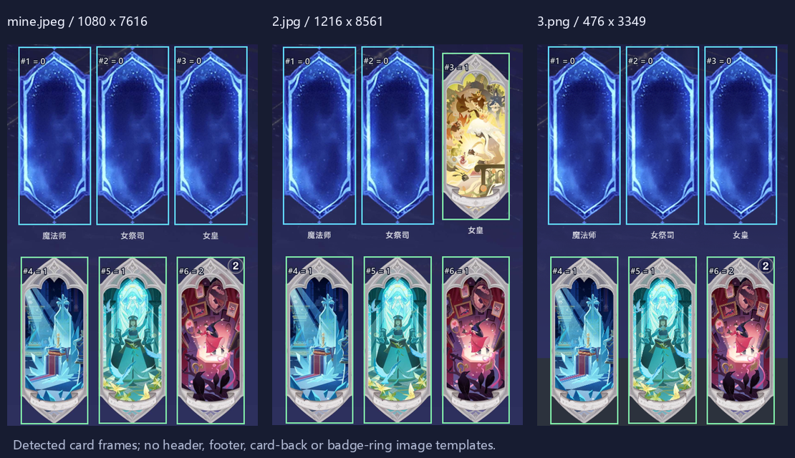

# 米游社图片导入 Box：自适应识别设计

日期：2026-11-13。**当前实施依据，网页功能已接入**。实际JavaScript识别核心已通过三张真实图片及36个用例回归；内置浏览器连接不可用，页面与真机实测尚未完成。

## 1. 设计结论

采用 **颜色分割 → 牌框连通区域 → 自动排列成行列 → 牌框拥有状态 → 局部数量识别**。

不以某一设备的导出尺寸作为标准，不依赖整张图片的固定坐标或宽高比，不要求存在页首、页尾、米游社标识或二维码。原图缩放、留边、页首页尾裁切、行间距变化由内容定位吸收。

牌背、页首文字、页尾标识和数量角标外圈都不再使用图片模板。**唯一保留的参考是数字“2”的16×24二值轮廓**，JSON文件493字节，原始位图仅48字节；无需加载PNG模板、OCR、OpenCV.js、WASM或模型，也不增加npm运行时依赖。

现有三张图均须通过同一套算法，不增加按文件名、设备或分辨率切换的配置：

| 原始图片 | 尺寸 | 已获得种类 | 总张数 | 2张牌 |
|---|---|---|---|---|
| `mine.jpeg` | 1080 × 7616 | 12 | 13 | 恋人 |
| `2.jpg` | 1216 × 8561 | 14 | 14 | 无 |
| `3.png`（用户称第三张图） | 476 × 3349 | 12 | 13 | 恋人 |



图中矩形由图片内容检测得到，没有读取玩家昵称、UID或顶部已解锁计数。

## 2. 取消此前的输入限制

| 之前的条件 | 当前处理 |
|---|---|
| 原图宽度至少540px | 取消；540px只是可调整的工作图宽度，不是文件准入门槛 |
| 原图宽高比接近1080:7616 | 取消；保留输入实际比例，不将整图强行拉伸到固定高度 |
| 固定3列、879px行距、固定起点 | 根据检测到的牌框中心聚类，推断列、行及每个牌位 |
| 页首文字模板必须通过 | 取消，不识别页首文字 |
| 页尾米游社标识必须存在 | 取消，页首页尾均可裁掉，只要牌区仍在 |
| 必须识别完整22个牌框才接受 | 取消；已识别牌先展示，局部未识别项保留为待确认 |
| 蓝色牌背局部必须匹配 | 改成牌框两侧的颜色分布，不比较牌背纹理 |
| 数量角标外圈必须匹配PNG | 改成圆环轮廓及内外亮度差，不加载圆环图片 |

支持不同图片分辨率是算法目标，低清或局部损坏只影响相关牌的置信度。尺寸变化本身不作为拒绝理由。

## 3. 定位：直接寻找牌框

### 3.1 预处理

解码本地图片，保留真实宽高比，按工作宽度缩放以控制计算量。当前离线验证采用540px宽；实现时可在牌框过小或细节不足时提高工作分辨率或仅重采样相关局部。

图像解码、像素读取使用浏览器原生能力。处理过程分批执行、允许取消；图片原始像素不写进Alpine持久化状态。大图通过降采样及局部处理控制开销，不为支持不同设备增加图片尺寸白名单。

### 3.2 颜色掩码与连通区域

对像素建立两类宽松颜色掩码：高饱和蓝色、较亮银灰色。当前验证使用以下初始条件，RGB范围为0–255：

```js
const blue = b - r > 30 && g - r > 10 && b > 110;
const silver = Math.max(r, g, b) - Math.min(r, g, b) < 45
  && (r + g + b) / 3 > 115;
const foreground = blue || silver;
```

对合并后的掩码做小范围闭运算，连接压缩、缩放产生的细小断口。再按8邻域寻找连通区域，记录边界矩形和面积。[闭运算原理](https://docs.opencv.org/4.x/d9/d61/tutorial_py_morphological_ops.html)、[连通区域及边界统计](https://docs.opencv.org/4.x/d3/dc0/group__imgproc__shape.html)

这些是像素数组操作，浏览器可以直接用TypedArray和并查集实现。引用的图像处理文档仅解释原理，不代表引入OpenCV依赖。离线验证同样只使用Pillow，连通区域由脚本自行实现。

### 3.3 筛选与排列

先保留形状较长、面积足够的区域，再根据同图中区域的尺寸一致性选出主体牌框，去掉插画碎片、文字和二维码等小区域。形状、最小工作像素数用于过滤噪声，不是对原图分辨率的限制。

使用检测到的牌框中心分别聚类，得到列和行。按行从上到下、同一行从左到右映射牌ID；22是当前业务牌种数，不能转换为“必须检测到22个框”的输入门槛。检测代码推断列数，现有实测图片均为3列，其他列数仍需对应样本验证。

局部漏框而其余行列仍可确定时，在对应牌位留下空值。例如遮掉圣职者，只标记ID 5待确认，其余21张仍输出结果。

如果整行被裁掉、首张牌位置不明，自动映射可能有歧义：保留检测到的牌区，提供“框选牌区、指定首张牌/列数、修正牌位”的辅助校准，不因单张失败放弃所有已识别内容。

## 4. 拥有状态：沿检测到的牌框取颜色

采样区域相对于每个实际检测出的牌框，而不是相对于整张长图。

在牌框高度约25%–75%的范围，分别检查左右边缘窄带；沿窄带搜索连续竖向边框，统计最稳定的几列蓝色和银灰色比例。这样可以吸收卡框宽度、边缘位置和缩放取整误差，避免固定4px窄条恰好偏出边框。

- 两侧都有稳定银灰框：已获得。
- 两侧都有稳定蓝框、没有稳定银灰框：未获得。
- 左右证据冲突或颜色不清：该牌待确认，继续处理其他牌。

已获得插画本身可能呈蓝色，必须优先识别外侧银灰框，不能以整张插画的蓝色比例决定拥有状态。本次已覆盖全已获得和全未获得的合成图，定位不依赖至少出现一种特定牌背。

## 5. 数量：圆环结构 + 唯一的“2”字轮廓

只在已获得牌的实际右上角附近处理小区域，位置和范围都相对于该牌框尺寸。

### 5.1 角标存在性

在角落搜索小圆环，比较圆周与内外邻近像素的亮度差，以及足够多方向上的圆环支持率。圆心、半径随牌框大小变化；不匹配某张图片截出的圆环。

当前原型按24个方向采样，圆环证据清晰则认为有数量标记，证据不足时保留待确认，不将未知数字默认为1。

### 5.2 数字内容

将局部白色笔画提取为连通区域，裁到字形实际边界，再归一化到16×24。与用户提供的“2”字二值轮廓比较Dice相似度。

用多档亮度切分、细小断口连接和归一化后的±1px对齐，吸收JPEG和缩放导致的笔画断裂、粗细变化。这里始终只有一个“2”字参考，不针对设备或分辨率增加模板，也不在整张图上滑动搜索数字。

对应素材为 [`digit-two.json`](../assets/recognition/miyoushe-flexible/digit-two.json)，**493 B**。PNG原始裁片保留用于开发期重新生成，正式网页只引用这份小型JSON。

### 5.3 合成数量

| 证据 | 输出 |
|---|---|
| 明确未获得 | 0 |
| 已获得，明确没有数量角标 | 1 |
| 已获得，圆环存在且“2”轮廓明确匹配 | 2 |
| 有角标但数字不是可确认的2，或证据冲突 | 待确认 |

“无角标”的判定阈值依据实测：真实“2”角标的圆环支持率≥0.71、数字相似度≥0.83；无角标牌因插画亮线，圆环支持率最高0.50、相似度最高0.59。因此“无角标”取圆环支持率<0.6且相似度<0.65。旧阈值<0.5恰好落在最大无角标值上，`am.jpeg`（第三方导出，696×4850）在Box/Lanczos缩放下会让恋人、星变成待确认，同样的边界问题也出现在`3.png`。放宽后，4张图×缩放/JPEG/留边/裁切/行距变体共120例全部正确，24例未知数字角标仍保持待确认。

自动数量仍限定0 / 1 / 2，其他数量允许用户填写0–99。这是数字识别的功能范围，不是对整张图的拒绝条件。

## 6. 交互：接受部分结果，提供修正入口

```text
选择图片 → 自动定位牌区 → 展示已识别结果和待确认项 → 修正 / 辅助校准 → 应用到Box
```

不使用“分辨率不支持”“必须包含页尾”等文案。根据实际情况提示“这几张需要确认”“框选牌区继续识别”或“选择首张牌以校准顺序”。没有检测到牌区时仍保留重选和框选入口。

未确认项保持null，不能静默改为0或1；用户可以填写数量，或明确选择保留当前Box中的值。提交前确保22个最终数量均已确定。未确认和取消不会改变原Box。

应用规则延续现有业务：一次性替换counts，不相加；切换完整模式，保留keep、wantOff及UID等设置，quick按新Box和保留偏好重建（给出数量上限为9）；进行中的交换继续受业务锁定保护；不自动更新已发布换牌需求。图片不上传，只有用户提交后的Box数字进入既有本地持久化和B站同步。

## 7. 验证：三张图共用同一流程

开发脚本：[`scripts/evaluate-miyoushe-flexible.py`](../scripts/evaluate-miyoushe-flexible.py)。只依赖Pillow，不导入旧版布局配置，也不读取页首、页尾、牌背、圆环模板。独立答案文件仅用于结果核对，不参与定位或数量判断。

```powershell
python scripts/evaluate-miyoushe-flexible.py
```

完整结果见 [36个用例的验证报告](fixtures/miyoushe-box-flexible.validation.json)。**36/36符合预期**，其中32个用例完整自动识别，另外4个验证空白、局部缺失或未知数字的待确认行为。

| 类别 | 数量 | 验证结果 |
|---|---|---|
| 三张真实原图 | 3 | 全部22项数量正确 |
| 各图缩放到320 / 480 / 720 / 1280 / 1920px宽 | 15 | 全部数量正确 |
| 各图JPEG quality=50重压缩 | 3 | 全部数量正确 |
| 各图裁掉页首、页尾，保留牌区 | 3 | 全部数量正确 |
| 各图增加上下左右留边 | 3 | 全部数量正确 |
| 各图在中间增加行距 | 3 | 全部数量正确 |
| 全已获得 / 全未获得合成图 | 2 | 分别得到22个1 / 22个0 |
| 遮掉一张牌的合成图 | 1 | 仅该牌待确认，其余21张正确 |
| 将角标改为3 / 8的合成图 | 2 | 仅该牌数量待确认，没有错填为2 |
| 空白图 | 1 | 没有捏造22个已获得结果 |

以上是本地Pillow原型的实测，不等同于已完成浏览器或真机验证。其他未来图片继续走相同内容检测流程，信息不足时保留局部修正，不靠新增设备白名单或图片尺寸限制解决。

## 8. 网页实现边界与实施清单

已新增 `src/lib/miyoushe-box-import.js`，负责本地文件解码、Canvas缩放、区域选择和资源释放；`src/lib/miyoushe-recognition.js`是无DOM依赖的像素识别核心。两个模块只输出草稿。Alpine组件负责预览、校准、手动修正和一次性应用，不让识别过程直接改持久化数量。

资源只需要本地数字JSON。运行时图像操作用Canvas、TypedArray、行段扫描和并查集实现；图像处理按行分批执行，后续以真机数据决定是否使用Worker。

- [x] 三张原图共用算法验证。
- [x] 分辨率、JPEG、留边、页首页尾裁切、行距变化验证。
- [x] 局部漏框、未知数字、空白图的待确认验证。
- [x] 生成唯一需要的数字特征素材。
- [x] 将原型算法移植为JavaScript，接入图片选择、进度和识别预览。
- [x] 实现框选牌区、首张牌/列数校准、逐牌修正和原图局部核对。
- [x] 接入一次性数量替换、现有交换锁定、本地保存和云同步边界。
- [x] 实际JavaScript核心通过全部36个图片回归，验证待确认、取消和提交保护。
- [ ] 浏览器、移动端WebView的Canvas像素与页面交互实测：本次内置浏览器连接不可用，按用户要求跳过，不改用computer use。

入口为「我的Box → 从图片导入Box」及「我的 → 从图片导入Box」。识别模块通过动态import按需加载，构建后约9.1KB、gzip约4.2KB，无新增npm依赖。标准`npm test`会在本机存在样图和Pillow时生成临时RGBA输入，调用实际JS核心核对36个答案，不使用Python识别结果替代JS验证；临时图片测试目录会在测试结束后清理。

旧的[首轮固定坐标方案](miyoushe-box-import.md)及[逐图适配记录](miyoushe-box-import-adaptive.md)保留为历史资料，其中尺寸门槛、页首页尾校验和22个框齐全要求不再作为实施依据。
