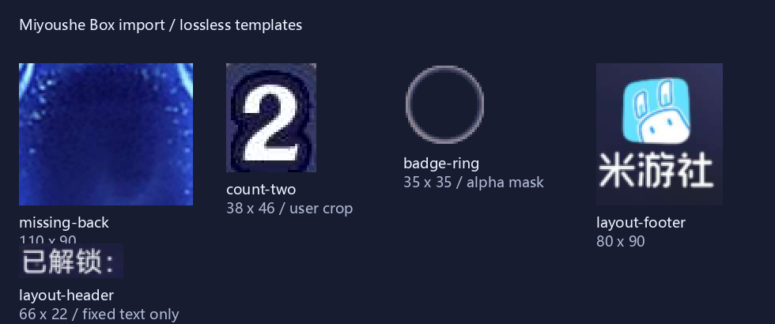

# 米游社导出图导入 Box：首轮方案（历史）

> 当前实施依据已更新为[自适应识别设计](miyoushe-box-import-flexible.md)：三张原图共用内容定位，不要求固定分辨率、宽高比、页首页尾或22个完整牌框；仅保留数字“2”的二值参考。本文保留早期方案和验证记录，以下限制不再生效。

日期：2026-11-13。状态：设计与素材准备完成，尚未接入网页。

> 跨设备修订（2026-11-13）：新增 `docs/assets/2.jpg` 后，确认旧的按宽度等比例归一化会累积坐标误差。当前推荐“分别归一化宽高 + 牌框颜色统计 + 数字小模板”，实测支持两张图；详见[跨设备评估与方案修订](miyoushe-box-import-adaptive.md)。下文保留首轮方案及单样图验证过程，定位和拥有状态判断以修订为准。

> 同日低分辨率补充：第三张实际为 `3.png`（476 × 3349）。修订文档第7节已验证“页尾标识 + 22个双侧牌框”，取代页首小字硬校验，并取消原图宽度至少540px的限制；数字阈值保持不变。

## 1. 结论与范围

采用 **Canvas + 固定网格 + 两类内容模板匹配**。不引入 OCR、OpenCV.js、WASM 或模型，不增加浏览器端第三方依赖。

1. 根据导出图布局一次生成 22 个牌位；用同一个蓝色未获得牌背模板，批量找出未获得的牌。
2. 在布局校验成功的前提下，未获得集合的补集就是已获得集合，不需要识别每张牌的插画或牌名。
3. 已获得牌右上角匹配用户提供的“2”字模板；命中记为 2，无数量角标记为 1，未获得记为 0。
4. 先预览和修正，再整体替换当前 Box 数量。识别过程全部在浏览器本地完成。

本次只交付本文、已裁好的素材、坐标配置与离线验证结果；网页入口和识别模块列在第 9 节的后续实现清单中。

### 支持边界

首版针对 `docs/assets/mine.jpeg` 所代表的**米游社完整导出图**：3 列、22 张牌、固定顺序，末行只有愚者。支持同版式等比例缩放和适度 JPEG 重压缩。自动数量限定为 0 / 1 / 2。

裁剪图、带手机状态栏的截图、旋转图、拼接图、其他列数及新版布局不进入自动覆盖流程。数量大于 2 不作自动推断；检测到数量角标、但“2”不命中时要求手动填写。当前只有一张真实导出样本，不能据此声称其他版本和用户图片均已验证。

## 2. 已确认的样图数据

原图尺寸为 **1080 × 7616**，文件 671,510 字节。图片中的牌序与 `src/data/cards.js` 的 ID 1–22 一致，愚者使用 ID 22。

| 行（从 0 开始） | 第 1 列 | 第 2 列 | 第 3 列 |
|---|---|---|---|
| 0 | 1 魔法师：0 | 2 女祭司：0 | 3 女皇：0 |
| 1 | 4 皇帝：1 | 5 圣职者：1 | 6 恋人：2 |
| 2 | 7 战车：0 | 8 力量：0 | 9 隐者：1 |
| 3 | 10 命运之轮：1 | 11 正义：1 | 12 倒吊人：0 |
| 4 | 13 死神：1 | 14 节制：0 | 15 魔鬼：1 |
| 5 | 16 塔：0 | 17 星：1 | 18 月亮：0 |
| 6 | 19 太阳：0 | 20 审判：1 | 21 世界：1 |
| 7 | 22 愚者：1 | 不生成牌位 | 不生成牌位 |

对应 `counts`：

```js
[0, 0, 0, 1, 1, 2, 0, 0, 1, 1, 1, 0, 1, 0, 1, 0, 1, 0, 0, 1, 1, 1]
```

结果为 **12 / 22 种已获得，共 13 张**。其中 10 种未获得，恋人 2 张，其他已获得牌各 1 张。

人工核对值保存在 [expected.json](fixtures/miyoushe-box-v1.expected.json)，用于验证结果；正式网页不读取这份答案。

## 3. 已准备的模板

运行时素材放在 [`assets/recognition/miyoushe-v1/`](../assets/recognition/miyoushe-v1/README.md)。项目当前忽略 `docs/assets/`，所以将需要随项目保存的模板放在独立、未被忽略的目录，原图仍留在原位置。



下表中的矩形统一为原图坐标 `[x, y, 宽, 高]`，原点在左上角。缩小的 PNG 保留缩放结果的像素，不再作有损编码；“2”模板保留用户附件的原始像素。

| 文件 | 来源矩形 | 保存尺寸 | 实际大小 | 用途 |
|---|---|---|---|---|
| `missing-back.png` | `[94, 510, 220, 180]` | 110 × 90 | 13,336 B | 蓝色牌背局部，避开名称、数量和外部背景 |
| `count-two.png` | 用户提供的附件；在原图对应 `[966, 1286, 38, 46]` | 38 × 46 | 3,962 B | “2”字模板；匹配时缩小为 19 × 23 |
| `badge-ring.png` | `[949, 1277, 70, 70]` | 35 × 35 RGBA | 3,627 B | 判断是否存在数量角标；只比较外圈，数字内部透明 |
| `layout-header.png` | `[44, 280, 132, 44]` | 66 × 22 | 3,184 B | 固定“已解锁：”文字，不包含可变的 `12/22` |
| `layout-footer.png` | `[42, 7410, 160, 180]` | 80 × 90 | 9,687 B | 米游社固定标识，校验是否为完整导出图 |

5 个 PNG 共 **33,796 B（约 33.0 KiB）**；坐标与阈值配置 [`layout.json`](../assets/recognition/miyoushe-v1/layout.json) 为 2,652 B，合计约 **35.6 KiB**。预览图、原图和验证报告不进入网页构建依赖。

额外的角标外圈模板用于区分“没有角标”和“有角标但不是可识别的 2”；两个布局模板用于避免任意图片因牌背不匹配，被反推成全部已获得。它们不涉及 OCR。

## 4. 坐标与识别算法

### 4.1 归一化与布局校验

浏览器读取用户选择的本地 JPEG / PNG，优先通过 `createImageBitmap(file)` 解码，缺少能力时使用 `Image` + Object URL。随后等比例绘制到宽 **540px** 的 Canvas，原图对应高度 3808px。采用平滑缩放，统一按 sRGB 的 8 位 RGB 值比较。

首版建议限制文件不超过 10 MiB、解码后不超过 1600 万像素，宽度至少 540px；解码失败或超限给出提示。文件 MIME / 扩展名只作为初筛，最终以实际解码结果为准。宽高比例须满足：

```text
abs((输入高度 / 输入宽度) / (7616 / 1080) - 1) <= 0.01
```

按以下顺序校验：

1. 在预计位置周围 ±4px（540px 工作图坐标）匹配页首固定文字及页尾标识，两个都通过才继续。
2. 两个匹配位置的偏移量在每个方向上最多相差 2px。取平均并四舍五入，作为网格的整体平移量。
3. 22 个牌位的内容区域及搜索区域必须完整落在图片内。任一校验失败，返回“图片版式暂不支持，请使用米游社导出的完整图片”。

这样全收集、完全没有蓝色牌背时仍可定位：**布局定位不依赖至少有一张未获得牌**。无需整张长图滑窗搜索，也不需要由检测到的少数牌背拟合行列。

### 4.2 一次生成 22 个牌位

统一在 1080px 标定坐标中计算，再乘 `540 / 1080`。配置的牌位不是精确卡面边界；它是包含卡框和装饰的固定参考区域，已获得卡框与未获得卡框略有不同。

```js
// i = 0..21；全部坐标为标定原图坐标。
const col = i % 3;
const row = Math.floor(i / 3);
const slotX = 46 + col * 337;
const slotY = 362 + row * 879;
const cardId = i + 1;

// 相对牌位原点的三个内容区域：
const missingRect = [48, 148, 220, 180];
const twoRect = [246, 45, 38, 46];
const badgeRect = [229, 36, 70, 70];
```

每个内容区域的工作图左上角为 `Math.round(标定坐标 / 2) + 整体平移量`。尺寸直接采用上表中的匹配尺寸，不分别累加取整后的行距，避免底部坐标累计误差。

每个区域只在预计位置附近 **±3px** 搜索。样图中存在约 1–2 个原图像素的位置误差，这个范围足够覆盖。首版没有任意裁剪后的重新对齐机制。

### 4.3 两个比较指标

用灰度的**零均值归一化相关系数（ZNCC）**比较纹理，再用 RGB 的平均绝对误差（MAE）约束颜色。两者都只需普通 JavaScript 数值循环。

```text
gray = round(0.299 * R + 0.587 * G + 0.114 * B)

ZNCC = Σ((T - mean(T)) * (P - mean(P)))
       / sqrt(Σ(T - mean(T))² * Σ(P - mean(P))²)

MAE = Σ(|T.R-P.R| + |T.G-P.G| + |T.B-P.B|) / (像素数 * 3 * 255)
```

ZNCC 越接近 1 越相似，MAE 越接近 0 越相似。模板和待测区域的大小必须相同。待测区域方差接近 0 时 ZNCC 定义为 0，不能让纯色区域被当作高分匹配。

搜索每个整数偏移，选择 ZNCC 最高的候选，并计算**同一候选位置**的 MAE；不能分别取两个位置的最优分数拼在一起。角标外圈仅按 `alpha >= 128` 的像素比较 RGB MAE，选择误差最小的候选，不比较透明内部。

### 4.4 识别未获得，再反推已获得

初始阈值如下；数值来自本次单样图标定，浏览器接入时仍需校准：

| 判断 | 条件 |
|---|---|
| 布局模板通过 | ZNCC ≥ 0.90，且 MAE ≤ 0.08；两个模板均须通过 |
| 未获得牌背明确匹配 | ZNCC ≥ 0.92，且 MAE ≤ 0.06 |
| 牌背明确不匹配 | ZNCC ≤ 0.70，且 MAE ≥ 0.10 |
| “2”字匹配 | ZNCC ≥ 0.92，且 MAE ≤ 0.10 |
| 数量角标存在 | 外圈 MAE ≤ 0.09 |
| 数量角标不存在 | 外圈 MAE ≥ 0.14 |

先批量比较 22 个牌位的牌背局部，得到 `missingIds`。布局有效、牌背明确不匹配的牌位作为已获得候选；落在阈值中间区间的格子进入待确认，不直接取补集赋值。

对已获得候选在固定右上角检查“2”和数量角标外圈，组合结果：

| 牌背判断 | 数量区域 | 自动结果 |
|---|---|---|
| 明确匹配 | 无角标，且“2”不命中 | 0 |
| 明确不匹配 | 有角标，且“2”命中 | 2 |
| 明确不匹配 | 无角标，且“2”不命中 | 1 |
| 其他组合 | 中间分数、未知数字、互相矛盾 | 待确认 |

**未匹配到“2”不能单独作为 1 张的依据**。有角标但数字无法识别时保留 `null`；预览要求用户填写数量，允许手动输入 0–99，沿用现有 Box 的范围。

首版不识别顶部已解锁总数、昵称或 UID，不把它们当作自动纠错依据。可在预览中展示“已获得种类 / 22、总张数”，方便用户对照原图。

### 4.5 工作量与内存

牌背比较的上限是 `22 × 7 × 7 × 110 × 90`，约 1070 万个灰度采样比较，另有很小的数字及外圈区域。复杂度随 22 个固定格子增长，不随长图上所有可能位置增长。

每个牌位一次读取包含搜索边距的局部 `ImageData`，在数组上移动比较窗口，避免每个候选都调用 `getImageData()`。模板只解码和预计算一次。

540 × 3808 的 RGBA 工作图约占 7.8 MiB；1080 × 7616 原图的解码像素另约占 31.4 MiB，解码实现还可能产生临时副本。无需将整张原图转成 Base64 或复制进 Alpine 状态。任务完成后关闭 `ImageBitmap`、撤销 Object URL、释放 Canvas；预览所需的小块缩略图可单独保留至抽屉关闭。

首版先在主线程分批处理，每处理一行让出执行权；识别过程可取消、重新选图会使上一轮结果失效。若真机测得明显卡顿，再增加 Worker，现阶段不预设 Worker / OffscreenCanvas 依赖。性能目标为常见手机 1 秒内进入预览，**尚无浏览器实测结论**。

## 5. 网页交互与 Box 接入

### 5.1 用户流程

在“我的 Box”增加“从米游社图片导入”入口；“我的 → 导入圣牌 Box”中保留原有字母码，并可选择“米游社图片”。两个入口打开同一个图片导入抽屉，不新增路由。

```text
选择完整导出图 → 本地识别 → 22 张牌的数量预览 / 修正 → 导入并替换 Box
```

选图前说明：“选择米游社导出的完整图片，图片仅在本机识别。自动识别 0、1、2 张，其他数量请手动修正。”预览使用现有卡图和名称，显示当前数量与导入数量的差异；待确认牌突出显示，并可查看对应原图局部。提交按钮显示“导入并替换 Box”，在有待确认数量、正在识别或有进行中交换时禁用。

取消或失败不修改当前 Box。识别模块只产生草稿，不直接调用现有 `setCount()`，也不触发收集动效、持久化或云同步。提交前再次检查当前是否已有进行中的交换，避免预览期间状态变化。

### 5.2 写入规则

图片只携带持有数量，不是字母码中包含设置的完整快照，因此独立提供 `applyImageBoxImport()`，不将图片结果伪装成字母码后调用 `importBox()`。

| 字段 / 行为 | 图片导入后的规则 |
|---|---|
| `counts` | 22 个数量一次性替换，不与当前数量相加；重复导入同一图不会翻倍 |
| `mode` | 切换为 `full`，直接展示识别得到的完整 Box |
| `keep` | 保留用户当前设置；默认保留 1 时，2 张才产生 1 张可换数量 |
| `wantOff` | 保留；图片不能表达用户“不想要”的选择 |
| `quick` | 保留原来的快速选牌，当前完整模式不使用它 |
| UID、身份、交换记录 | 保留，图片不识别这些信息 |
| 进行中的交换 | 沿用现有 `activeMatches.length` 检查，禁止覆盖 |
| 已发布的换牌需求 | 不自动发布、撤回或更新；沿用 `listingDirty` 提示用户手动更新 |
| 保存与同步 | 提交后沿用现有 `snapshot()` 的本地持久化和 B站云同步；同步的是 Box 数字，不含图片 |

将 `batch` 设为 `false`、筛选恢复为 `all`，关闭导入抽屉并进入 Box。中英文文案沿用 `src/i18n.js`，不把匹配分数或坐标呈现给普通用户。

现有 `src/main.js` 的 `counts` 可直接承接结果；设计稿第 10 节曾提到的 `store/box.js` 尚不存在，“待确认”也不是当前已实现的持久化字段。本方案将待确认状态仅放在导入草稿中，直到全部确认后再写入正常数量数组。

## 6. 模块与构建方式

以下文件为**后续拟新增或修改的位置**，本次未接入：

| 位置 | 职责 |
|---|---|
| `src/lib/miyoushe-box-import.js`（拟新增） | 本地解码、布局检查、固定格子模板匹配、释放资源；不访问业务状态 |
| `assets/recognition/miyoushe-v1/layout.json`（已准备） | 固定布局、模板地址、搜索范围、初始阈值 |
| `src/main.js` | 导入草稿、取消 / 重选控制、预览与整体提交、交换状态检查 |
| `src/partials/box.html` | 图片导入入口 |
| `src/partials/sheets.html` | 选图、进度、数量预览、待确认与提交 |
| `src/i18n.js`、`src/styles/` | 文案及抽屉样式，复用现有卡牌与数量控件 |

识别模块的拟定接口：

```js
recognizeMiyousheBox(file, { signal, onProgress })
// Promise<{
//   profile: 'miyoushe-box-v1',
//   counts: Array<number | null>, // 固定 22 项，null 必须人工确认
//   cards: Array<{
//     id: number,
//     status: 'recognized' | 'review',
//     reason: null | 'uncertain-back' | 'unknown-badge' | 'conflict',
//     sourceRect: [number, number, number, number]
//   }>
// }>
```

全局布局错误直接返回可区分的 `UNSUPPORTED_LAYOUT`；其他全局错误区分无法解码、超出尺寸限制和用户取消。取消不显示失败提示；旧任务完成后不得覆盖新任务草稿。

点击导入入口后通过动态 `import()` 加载识别模块；仅由该模块静态引用模板和 JSON。PNG 使用 Vite 的 `?no-inline` 资源导入，让小图也有构建后的相对地址，避免写死 `/assets/...` 或将 Base64 拼进入口代码，兼容项目现有 `base: './'` 的子目录部署。文件命名即布局版本，后续真实出现新版布局时增加配置，不在首版构造通用版式检测系统。[Vite 静态资源文档](https://vite.dev/guide/assets.html#explicit-inline-handling)

浏览器只需要原生文件读取、图片解码和 Canvas 区域像素访问。用户图片以本地 File / Blob 输入，模板来自本站，避免跨域图源导致 Canvas 无法读取；浏览器若禁止读取像素则显示错误并允许手动录入。[createImageBitmap 文档](https://developer.mozilla.org/en-US/docs/Web/API/Window/createImageBitmap)、[getImageData 文档](https://developer.mozilla.org/en-US/docs/Web/API/CanvasRenderingContext2D/getImageData)

“本地识别”意味着不上传图片或调用识别服务；首次加载网页和模板仍需站点资源。断网使用需要资源已加载，当前项目没有实现离线缓存，不能承诺首次离线打开也可识别。

## 7. 已完成的离线验证

素材脚本仅依赖开发环境的 Python + Pillow，不使用 OpenCV / NumPy，不为网页增加依赖。结果保存在 [validation.json](fixtures/miyoushe-box-v1.validation.json)。

| 验证输入 | 结果 |
|---|---|
| 原始 `mine.jpeg` | 22 项与人工答案全部一致 |
| 等比例缩小为 720px，再以 JPEG quality=70 保存 | 22 项与人工答案全部一致 |
| 合成异常：抹去“2”字内部、保留角标外圈 | 恋人标记为待确认，其他 21 项不变 |
| 同尺寸纯色图片 | 布局校验失败，未生成任何自动数量 |

原图实测的关键分数：

| 指标 | 数值 |
|---|---|
| 10 张未获得牌的最低牌背 ZNCC | 0.9825 |
| 10 张未获得牌的最高牌背 MAE | 0.0110 |
| 12 张已获得牌的最高牌背 ZNCC | 0.5286 |
| 12 张已获得牌的最低牌背 MAE | 0.1433 |
| 恋人的“2”字 ZNCC / MAE | 0.9999 / 0.0010 |
| 恋人角标外圈 MAE | 0.0519 |
| 其他无角标位置的最低外圈 MAE | 0.1648 |

这些数值说明当前模板在这张样图上有明确分离空间。它们属于单样本离线验证，不是跨用户准确率，也未验证 Canvas 与 Pillow 缩放、灰度转换差异。首版不直接宣称识别率 100%。

### 重新生成素材与结果

```powershell
# 原图仍位于 docs/assets/mine.jpeg；已保存的 count-two.png 作为原始2字输入。
python scripts/prepare-miyoushe-import.py --verify

# 更换用户提供的同尺寸模板时，可显式指定；不要将数字重新绘制成字体。
python scripts/prepare-miyoushe-import.py --two-template 'C:/path/to/two.png' --verify
```

脚本生成 PNG、`layout.json`、预览图、人工答案文件和验证报告。原图仅作为开发期输入；不会复制昵称、UID 或二维码到运行时模板。

## 8. 网页实现后的验收条件

1. 在浏览器导入原图及 720px 重压缩版本，得到与 `expected.json` 相同的 22 个数量。
2. 在 Chrome / Edge、iOS Safari 及 B站 App WebView 中验证解码和像素读取，必要时调整缩放及阈值；以浏览器结果作为最终依据。
3. 补充其他玩家的真实导出图，覆盖全部获得、全部未获得、第一行全已获得、末行未获得、多张“2”分散在不同列 / 不同行。校验无牌背时不依赖牌背寻找布局。
4. 其他数字、模糊角标、分数处于中间区间及牌背 / 数字矛盾时进入待确认；确认前无法提交。
5. 裁剪、旋转、其他列数及无关图片不会自动生成 22 个“1”；布局失败不修改已有 Box。
6. 验证取消、连续重选文件、识别时关闭抽屉和预览期间出现新交换的情况，不写入过期草稿或绕过交换锁定。
7. 提交只替换数量并进入完整模式；保留当前设置，不相加，不自动更新已发布换牌需求；图片数据不进入本地状态存储、云存储或识别请求。
8. 检查子目录构建中的资源地址和网络请求，确认首屏未加载识别模板、原图未出现在 `dist/`；测量真机时间与内存后评估是否需要 Worker。

## 9. 后续实现清单

- [ ] 实现固定布局的 Canvas 识别模块和资源懒加载，输出独立草稿。
- [ ] 添加选图、预览、局部核对与手动修正，复用现有 Box 卡牌及数量交互。
- [ ] 接入一次性替换、交换锁定和现有持久化；保留字母码导入行为。
- [ ] 完成浏览器、真机和补充真实样本的验收，记录最终阈值及构建体积。

此清单是后续实施范围，本次不开始修改网页功能。
